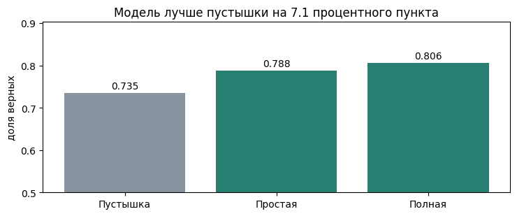

# Прогнозирование оттока клиентов — Telco Customer Churn

**Учебный проект:** DataGroup Academy, AI Engineering, Midterm (занятия 11–12).

## 1. Задача

Предсказать, уйдёт ли клиент телекоммуникационной компании (`Churn`: 1 — ушёл, 0 — остался), на основе характеристик клиента, договора и подключённых услуг. Тип задачи — бинарная классификация.

## 2. Данные

- Источник: [IBM Telco Customer Churn (CSV)](https://raw.githubusercontent.com/IBM/telco-customer-churn-on-icp4d/master/data/Telco-Customer-Churn.csv).
- Исходная таблица: **7 043 строки, 21 столбец**.
- Ушли: **1 869 клиентов (26,5%)**; остались: **5 174 (73,5%)**.
- Целевая переменная: `Churn`.

## 3. Что сделано

1. Проверены дубликаты и уникальность `customerID`: полных дублей и повторных ID нет.
2. Проверены невозможные значения, типы данных и выбросы.
3. Найдены **11 пустых значений `TotalCharges`** у клиентов со сроком обслуживания `tenure = 0`; после проверки они заменены нулём, столбец преобразован в числовой формат.
4. Создана функция `clean(raw_table)` и проверки качества данных (`assert`); очищенная таблица сохраняется в `data/telco_clean.csv`. Решения по очистке фиксируются в журнале.
5. Построены пять графиков EDA и сформулированы выводы.
6. Созданы четыре дополнительных признака: `is_new_customer`, `has_fiber_optic`, `is_long_term_contract`, `monthly_charge_log`.
7. Построена подготовка данных в `Pipeline`: обработка чисел, флагов и категорий (`OneHotEncoder`, порог редкости 10). На обучающей выборке получено **48 числовых признаков без пропусков**.
8. Проверен потенциально подозрительный признак `TotalCharges`; он исключён из основной модели, поскольку его доступность на момент прогноза требует подтверждения.
9. Сравнены три модели с кросс-валидацией на train; затем выполнена итоговая оценка на отложенном test.

## 4. Главное из EDA

- Доля ушедших клиентов — **26,5%**.
- При помесячном договоре доля ухода — **42,71%**; при договоре на год — **11,27%**, на два года — **2,83%**.
- Клиенты с небольшим сроком обслуживания чаще уходят.
- Ушедшие клиенты в среднем платили больше в месяц, чем оставшиеся; это связь, а не доказательство причины.

## 5. Проверка возможной утечки данных

При сравнении моделей с `TotalCharges` и без него средняя Accuracy на кросс-валидации составила **0,805997** в обоих вариантах (при показанной точности). Это не доказывает отсутствие утечки: решение об использовании столбца зависит от момента доступности данных. В итоговой модели `TotalCharges` исключён. `customerID` и целевая переменная `Churn` также не используются как входные признаки.

## 6. Результаты моделей

Метрика: **Accuracy** (доля правильных прогнозов). Для сравнения моделей использована кросс-валидация на обучающей выборке.

| Модель | Accuracy, кросс-валидация |
|---|---:|
| DummyClassifier (самый частый класс) | 73,46% |
| Простая модель (4 признака) | 78,82% |
| Полная модель (Pipeline + логистическая регрессия) | **80,60%** |

**Отложенный test:** DummyClassifier — **73,46%**, полная модель — **80,06%**. Улучшение относительно пустышки — **6,60 процентного пункта**.



## 7. Выводы и дальнейшие шаги

Полная модель показала лучший результат среди рассмотренных вариантов. При этом Accuracy не показывает отдельно, насколько хорошо обнаруживаются именно уходящие клиенты. Следующий шаг — оценить Recall, Precision, ROC-AUC, матрицу ошибок и возможные бизнес-издержки пропуска клиента с высоким риском ухода.

## 8. Как запустить

1. Скачайте репозиторий или откройте `project.ipynb` в Google Colab.
2. Установите зависимости из `requirements.txt`:

   ```bash
   pip install -r requirements.txt
   ```

3. Запустите все ячейки `project.ipynb` **сверху вниз**. Для загрузки исходного CSV требуется доступ к интернету.
4. Тетрадь создаёт очищенный файл `data/telco_clean.csv` и график `figures/baseline.png`. График также уже приложен к репозиторию.

## 9. Структура проекта

```text
project.ipynb           # анализ, очистка, признаки и модели
data/telco_clean.csv    # очищенные данные (создаются при запуске; в архиве не включены)
figures/baseline.png    # график сравнения моделей (создаётся тетрадью)
README.md               # описание проекта
requirements.txt        # зависимости, версии из сохранённого запуска Colab
```

**Примечание о воспроизводимости:** версии зависимостей перенесены из сохранённого вывода Colab. При запуске на другой платформе может потребоваться совместимая среда. Исходный CSV скачивается по ссылке из раздела «Данные»; без доступа к интернету при первом запуске загрузка не сработает. Полный повторный запуск в текущей среде не выполнялся из-за отсутствия сетевого доступа к исходному CSV. После загрузки в Colab следует выбрать «Перезапустить сеанс и выполнить все» и сохранить обновлённые результаты.
